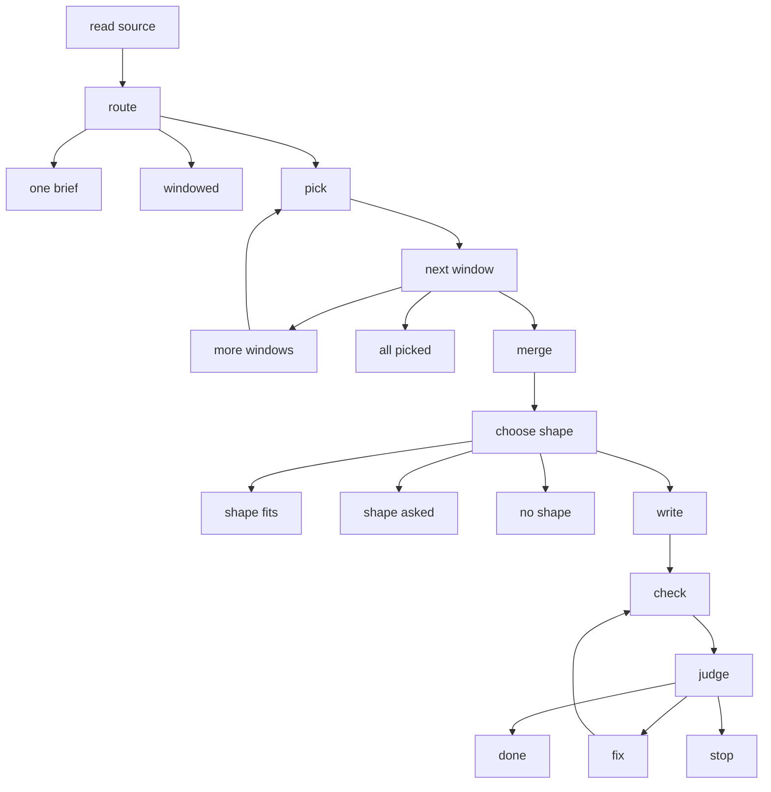

# footprint-conversation-chart

A conversation in, a checked storyboard out. A [footprintjs](https://www.npmjs.com/package/footprintjs) chart reads the
conversation window by window, picks what matters, chooses the story's shape in code, writes the board, checks it against
the whole conversation and against the tool that will draw it, and sends back one piece at a time until it reads. Its
record says why each choice was made.

**Why a package of its own:** the same chart serves every tool that draws a storyboard (a film, a deck). It needs
footprintjs, so it cannot live in `footprint-story`, which stays dependency-free. The tool plugs in as a port: the
shapes it draws and its own reader.

## Install

```bash
npm install footprint-conversation-chart footprintjs
```

Node 22 or later. `footprintjs` (^12) is a peer dependency; `footprint-story` comes with it.

## Example

A chatbot session file (one JSON record per line, as a coding assistant writes its sessions) to a storyboard, with your own model call:

```js
import {inProcess, storyFromConversation} from 'footprint-conversation-chart';

const result = await storyFromConversation({
  conversation: {session: 'session.jsonl'},       // or {file: 'chat.json'}, or {messages: [{id, who?, text}]}
  model: inProcess(async (brief) => myModel(brief.instructions, brief.material)),   // JSON text back
  drawer: {shapes: ['what-we-found'], problemsOf: (board) => myToolProblems(board)},
});
result.board;      // the read storyboard, or null when the run stopped (result.stopped says where and why)
result.standing;   // per scene: {standing: 'known' | 'not-sure' | 'ask', why, sources, point}
result.ask;        // what only the owner can answer; the run does not stop for it
result.problems;   // what was left, when the run stopped
result.record;     // {narrative, snapshot}: route, shape, fixes and every decide() with its evidence
```

Options: `shape` (ask for one), `window` (bytes per pick brief, 96 KB by default), `mostFix` (fix rounds, 3 by
default, at most 10), `cwd` (the folder a file is read in; the process's own by default).

### A host whose model answers from outside the run

An MCP tool, where the calling assistant is the model, cannot hand the chart a function to await. `storySession` runs
the same chart in the same process and hands each brief out; the host's next call answers it:

```js
import {storySession} from 'footprint-conversation-chart';

const session = storySession({conversation: {session: 'session.jsonl'}, drawer, idleMs: 10 * 60 * 1000});
let step = await session.next();                       // {brief} or {result}
while (step.brief) step = await session.answer(await askTheAssistant(step.brief));
step.result;                                           // what storyFromConversation gives
```

One brief is outstanding at a time. `next()` with a brief waiting gives that brief again, and after the end the same
result. `answer()` with no brief waiting, or a call while another waits, is refused and the session goes on. A session
that waits on the host longer than `idleMs` (30 minutes by default) ends with a refusal, and `cancel()` ends it at once;
every later call gets the same refusal.

## The ports

**The model.** Every stage that asks sends the same frozen brief, `{stage, instructions, material, expects, ids}`, and
takes JSON text back. `instructions` are code's words, the same whatever the conversation says; `material` is data
lines, one JSON value per line. A driver is `{answer(brief, at)}`, where `at` is `{stage}` and nothing more: a
driver never holds the chart's scope. `inProcess(fn)` awaits your call; `storySession` is the step-by-step one.

**The drawer.** `drawer = {shapes, problemsOf?}`: `shapes` lists the shapes the tool draws (from footprint-story's
shapes, each once); `problemsOf(board)` is the tool's own reader, given the read storyboard once it reads, answering
`[{at, message}]` for what the tool cannot draw, each at the board's place (`closing`, `checked[1]`), or `[]`. It may
answer with a promise. Leave it out when the tool draws every board that reads. A film's reader that throws with
`problems` is wrapped like this:

```js
const drawer = {shapes: FILM_SHAPES, problemsOf(board) {
  try { filmFromBoard(board); return []; } catch (error) { if (Array.isArray(error?.problems)) return error.problems; throw error; }
}};
```

## The chart

Drawn by `toMermaid()` from the real chart (`storyMermaid()`); `test/readme.test.mjs` fails when this drawing and the
chart differ.



Each stage lives in its own folder under `src/story/`, with a small README; `chart.mjs` is the wiring only, and
`engine.mjs` is the one module that calls footprintjs. See [src/story/README.md](src/story/README.md).

## Threat model

- **The conversation is untrusted, and so is what a model writes.** Words stay data: they reach a model only as a
  brief's material, apart from its instructions, and a planted instruction changes no instruction (tested).
- **Words never reach the record.** The chart's state, and so its record, holds counts, bytes, a sha256, window offsets,
  message ordinals and reason codes: never a message's or an answer's words, never a message's id, never the record
  kinds a session file names (a session's left-out records are one count). Ids come back on the result, from working
  memory.
- **Refusals are fixed words.** A stage error that is not one of the chart's own refusals becomes "the <stage> stage
  failed", its original kept under a private symbol and handed to the caller as `cause` once the record is taken. A
  JSON parser's message, which quotes the text, is never used.
- **Files stay inside `cwd`.** `file` and `session` are read by their real path (a link cannot lead out), must be
  regular files, and are capped (32 MB for a JSON list, 256 MB for a session, which is read a line at a time). A file
  is read again only when its stat changes, and refused unless its words hash the same.
- **Everything is bounded:** at most 5,000 messages, 200 windows a run, 1 MB an answer, 24 points, `mostFix` rounds,
  one brief outstanding per session and an idle timeout.

## Licence

MIT
